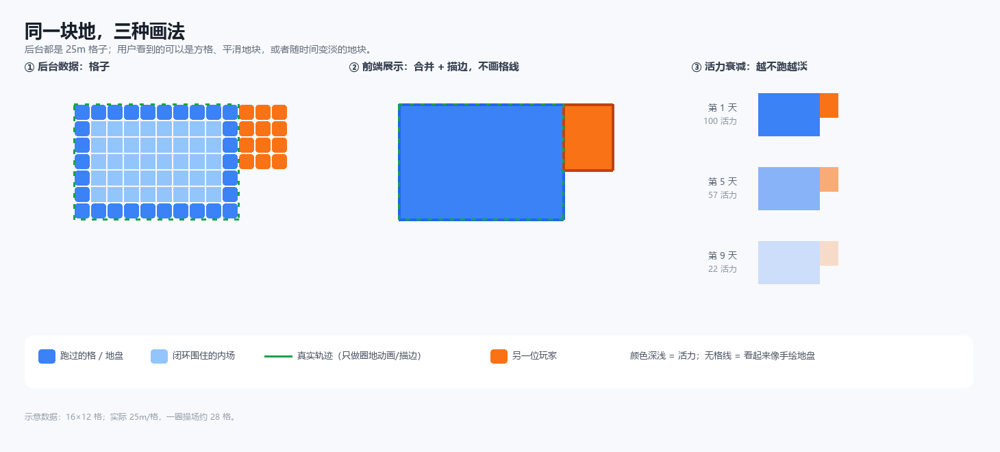
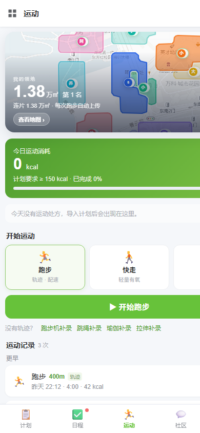
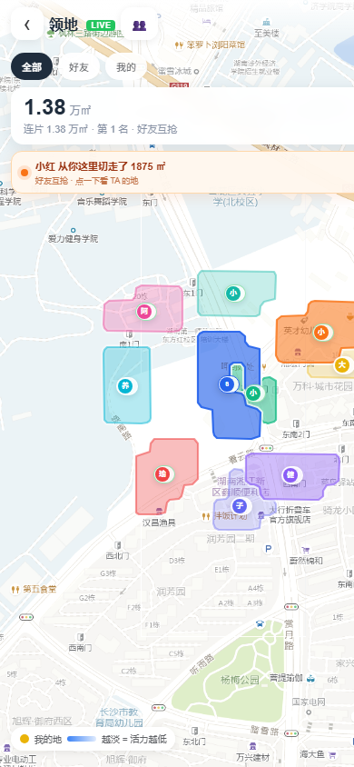
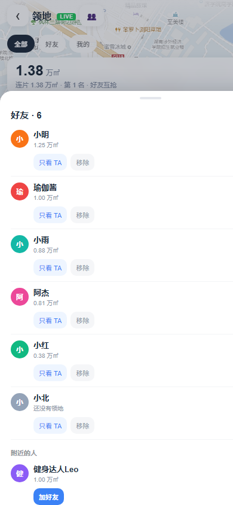
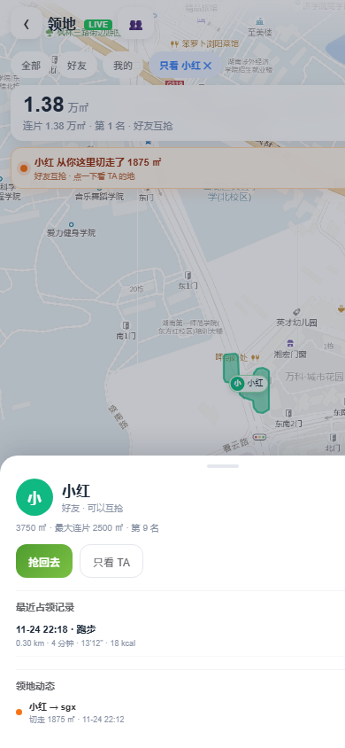

# 运动板块 · 「领地跑」玩法规则评审与完整设计

> 评审对象：`workouts` / GPS 轨迹 / `TrackMap` 这套现有运动能力，以及在其上新增的 10 条领地规则 + 公平性规则。
> 结论先行：**方向成立，而且和这个产品「饭后走、低门槛、每天动一点」的定位是能对上的；但按原样实现，有 5 个会直接毁掉体验的硬伤。** 下面先逐条评审，再给一版可以直接落地、可以给用户看的规则 v1.0，最后给数据表、接口、算法和分期。
>
> **2026-11 实现更新（对标 KYRO）**：闭环改为「首尾 ≤50m **或** 轨迹自交」；最小运动门槛改为 90 秒 / 150m（400m 操场一圈可圈）；内场改为整片填充，单次上限 0.08km² / 128 格。本文旧章节里的 30m / 600m / 6min / 60m 数值以本节和 [KYRO 对标文档](运动板块-KYRO对标与改进建议.md) 为准。

---

## 0. 30 秒结论

**值得保留的：** 格子占地、闭环圈地、活力衰减、连片加成、地标争夺、周结算、组队、护盾、默认关闭、只认真跑。这些规则组合起来，是一个「低门槛 + 有对抗 + 有日常维护」的轻量游戏，和跑步 App 的段位/路段（Strava Segment）是同一类乐趣，但更适合校园/城市片区。

**必须改的 5 处：**

1. **闭环填充可以「一圈吞掉整个校区」** —— 必须加「内场每格离轨迹 ≤ 60m」和「最多 120 格」，否则跑一个 2km 大圈，半个学校都成你的。
2. **规则 1 / 3 / 4 / 8 用了三种时间尺度，互相打架** —— 「跑过就永久亮」「一段时间不跑变淡」「被抢走」「每周结算」需要统一成一个 **0–100 的活力值**，否则产品自己说不清一块地现在到底算谁的。
3. **「跑得比你勤、次数比你多」不是一条可计算的规则** —— 没有伤害值、没有防守、没有冷却，结果要么「一次路过抢走 50 格」让人弃游，要么「怎么跑都抢不走」让人不跑。
4. **「点一下就能直接去抢回来」在当前数值下做不到** —— 抢回来的地活力 55，按原规则一次跑步只能打掉 45，要跑两趟；必须给「48 小时内夺回伤害 ×2」，才能兑现「一趟抢回」。
5. **隐私承诺和「格子颜色就是轨迹」是矛盾的** —— 一格宽的彩色路线就是你的跑步路径；必须做「起终点 300m 隐私区 + 15 分钟延迟发布 + 只返回格子不返回轨迹/时间」，否则规则 10 是空话。

**已经验证过的：** 仓库里新增了 [`scripts/territory_sim.py`](../scripts/territory_sim.py)，把网格、落格、闭环填充、衰减、抢夺、夺回都跑了一遍：

| 格子边长 | 400m 操场一圈 | 其中内场 | 同路线重复跑的重合度（平均） |
|---|---|---|---|
| 15m | 38 格 | 24 格 | 0.69（抖） |
| 20m | 34 格 | 12 格 | 0.91 |
| **25m（推荐）** | **20 格** | **8 格** | **0.96（稳）** |

- 2km 校区大圈：落格 126 格，内场被「最远 125m > 60m」拦下，**不会一圈吞校区**。
- 30 格的领地，每天衰减 8 点，约 **11 天**完全荒废；120 格时约 8 天，240 格时约 6 天（地盘越大越难守）。
- 100 活力的格子，防守方 24 小时内跑过：攻击方要 **4 次**才能抢走；被抢后 48 小时内夺回，**1 次**就能抢回。

> 说明：这些数字是「可玩性起点」，不是终值。上线后按实际参与人数调 `DECAY_BASE`、`ATTACK_DAMAGE` 两个参数即可，规则结构不用动。

---

## 1. 逐条评审

### 1.1 一张表

| # | 你的规则 | 判定 | 主要问题 | 处理建议 |
|---|---|---|---|---|
| 1 | 跑过哪个格子，哪个就亮成你的颜色 | ✅ 成立 | 格子多大？GPS 抖动会让边缘格忽亮忽灭；贴着格子线跑会占两列；坐标系用错会让整片地偏移约 500m | 25m WGS-84 网格；每格至少 2 个采样点；每次最多占 100 格；渲染时再转 GCJ-02 |
| 2 | 绕一圈，中间围住的也归你 | ⚠️ 有趣但最危险 | 一圈可以吞校区；GPS 缺口会「漏水」；8 字/自交；内场有别人的地怎么办；暂停跨段算不算 | 闭环 30m 内；内场每格离轨迹 ≤60m；最多 120 格；只填无主/自己的；暂停断段不闭环 |
| 3 | 一段时间不跑，颜色变淡，最后无主 | ✅ 成立 | 「一段时间」没定义；什么时候结算；面积大是否更难守；护盾防不防衰减；后台任务不可靠 | 活力 0–100；每天 04:00 结算；懒计算 + 每小时清扫；8/天 + 面积税 + 7 天未跑额外 4；护盾不防荒 |
| 4 | 朋友跑得比你勤、次数多，地就变成他的 | ⚠️ 方向对，规则不成立 | 「勤/次数」不可计算；一次路过抢走一大片；没有冷却可以绕圈刷；没有防守，老用户被偷家 | 伤害 45；24h 内跑过 ×0.6；同格同人 8h 冷却；每次跑步同格只算一次；新主 55；每天最多攻击 30 格 |
| 5 | 被抢提醒，点一下直接去抢回 | ⚠️ 承诺过高 | 没有推送通道；不能瞬移；按原数值要跑两趟才抢得回；提醒会刷屏；会暴露你「现在没在跑」 | 站内动态 + 红点；15 分钟聚合；48h 复仇任务；夺回伤害 ×2；点击 = 地图定位 + 导航 + 开始跑步 |
| 6 | 连在一起的格子越多加成越大，有称号徽章 | ✅ 成立 | 只算最大块还是全部？加成多少？会不会滚雪球？ | 4 邻接；5/15/40/100 格 → 周积分 ×1.1/1.25/1.5/2.0；只作用于周结算；面积税对冲 |
| 7 | 操场、食堂、江边设地标格，奖励翻倍，最容易打起来 | ✅ 成立 | POI 从哪来？食堂是室内；江边太长；翻倍会通胀；护盾会让地标死掉 | 种子 JSON + 管理端；地标 = 中心+半径/多边形；食堂改「食堂前广场」；地标格面积 ×2；不可护盾；占 ≥50% 才算 |
| 8 | 每周结算，比地多、连片大、抢回多，上榜发积分徽章 | ⚠️ 需要防滚雪球 | 总地盘会变成「先来的人永远赢」；结算丢失/重复；时区；并列；刷夺回 | 周榜看「本周新拓 / 最大连片 / 夺回 / 地标」；总地盘只发称号；周一 00:05；period_key 幂等；补结算；防合谋 |
| 9 | 拉朋友组队，地合并算；积分买护盾，几天不被抢 | ⚠️ 合并产权会出问题 | 合并后衰减/护盾/退队算谁的？没有好友系统；护盾价格；地标护盾；小号养大号 | 队伍 ≤4，邀请码；只合并展示和团队榜，产权仍归个人；队友免伤 + 助跑；退队 7 天冷却；护盾 10 分/格/天，最多 3 格 72h |
| 10 | 默认关闭，别人只看到颜色，看不到轨迹和时间；家附近不参与 | ⚠️ 承诺与实现有差距 | 一格宽的彩色线就是轨迹；实时更新能推断你何时跑；家附近留空洞反而暴露；退出后数据怎么办 | 默认关；起终点 300m 隐私区；15 分钟延迟；只返回格子/昵称/活力；退出立即释放；匿名昵称；分享脱敏 |
| + | 只认真跑，坐车/骑车/手动不算 | ✅ 必须做，但不能说满 | Web 端挡不住模拟定位；慢骑和慢跑速度重叠；跑步机是真跑但没轨迹；手环有真实运动但没轨迹 | GPS + 跑步/快走；时长/距离/点数/配速/移动占比五道门槛；骑行/跑步机/手动/手环/课程不计领地；异常复核 + 影子封禁；明确「不能 100% 防伪」 |

### 1.2 五个必须先修的硬伤

#### 硬伤 1：闭环填充，一圈可以吞掉整个校区

你的规则原文是「绕着一片地方跑了一圈，中间被围住的那片也一起归你」。这句话在方格地图上有三种被玩坏的方式：

- **大圈吞城**：绕学校外墙跑一圈（约 2km），中间一大片（几十个足球场）全归你。这不是「圈地」，这是「圈校」。
- **GPS 漏水**：轨迹在围墙上有个 2～3 格的缺口，洪水填充会从缺口灌进去，整个内场变成「外部」，一格都填不出来。
- **自交/8 字**：跑一个 8 字，两个环都算「内部」；跑两圈重复填；在操场来回折返也可能误判。

**改法（已在仿真里验证）：**

1. 首尾距离 ≤ 30m，且轨迹长度 ≥ 300m，才算闭环；暂停/后台断段不参与闭环。
2. 把轨迹格当墙，从包围盒边界做 4 邻接洪水填充；没被淹到的格 = 内部。
3. 墙上 1 格宽的缺口用「两端是墙、中间空一格」的方式桥接，**不要整体膨胀**——整体膨胀 1 格会把 25m 操场的内场（只有 8 格）直接吃掉。
4. 内场**每一格**到最近轨迹格的距离都必须 ≤ 60m（取最大值，不是最小值）。这条是「小圈算圈地、大圈不算」的分界线：400m 操场最远约 35m，能填；500×300m 校区大圈最远约 125m，填不了。
5. 内场最多 120 格；只填无主格或自己的格；别人的格不白送，改成「围城」：每个被围住的敌方格 -20 活力（可以放到 P2）。
6. 每次跑步只填一次；填充格活力 50，不是 100——围来的地比跑出来的地「虚」，更容易被抢，符合直觉。

#### 硬伤 2：三种时间尺度打架

- 规则 1 说「跑过就亮」——永久。
- 规则 3 说「一段时间不跑变淡」——有寿命。
- 规则 4 说「被抢走」——可易主。
- 规则 8 说「每周结算」——周期性重置预期。

如果一块地同时是「永久产权 + 会衰减 + 会被抢 + 每周结算」，用户会问：**周五晚上我占了 20 格，周一早上这 20 格到底还算不算我的？**

**改法：只保留一个状态量「活力 V（0–100）」，所有规则都作用在 V 上：**

| 事件 | 对 V 的作用 | 归属 |
|---|---|---|
| 第一次跑过无主格 | V = 100 | 你 |
| 跑过自己的格 | V = min(100, V + 20) | 你 |
| 别人跑过你的格 | V -= 伤害 | 仍是你，直到 V ≤ 0 |
| V ≤ 0 | V = 0 | 变无主，或易主给最后一击的人（V = 55） |
| 每天 04:00 | V -= 衰减 | 不变，直到 0 |
| 周结算 | 只读快照，不改 V | 不变 |

颜色深浅 = V/100，用户一眼就能看懂「这块地快没了」。周结算只是「拍照发奖」，不重置地图；这样「永久感」和「流动感」就不打架了。

#### 硬伤 3：「跑得勤」没有可计算的定义

「朋友跑得比你勤、次数比你多，这块地就变成他的」至少有四个歧义：

- 是「一周跑 5 次的人」赢，还是「一个月跑 20 次的人」赢？
- 是「经过一次就抢」，还是「跑够几次才抢」？
- 你昨天刚跑过，他今天跑一次，算谁勤？
- 他绕着你那块地跑 10 圈（同一格经过 10 次），算 10 次吗？

**改法：把「勤」翻译成「有效进攻次数」，并给防守方还手空间：**

- 每次有效跑步，对同一格只结算 **1 次**（防止绕圈刷）。
- 基础伤害 45；防守方 24h 内跑过该格 → ×0.6（27）；48h 内被抢、现在来夺回 → ×2（90）。
- 同一攻击者对同一格，**8 小时冷却**；每天最多攻击 30 格。
- 新主打下来后 V=55，不是 100——给夺回留窗口。
- 防守方跑一次自己的格 +20，可以「修墙」；但面积越大，每天基础衰减越高，修不过来——这就是「勤」的真正含义：**不是一次跑得多，而是持续来维护**。

这样「跑得比你勤」= 4 次有效进攻 vs 你 0 次维修；你每天跑一次，他就得多跑两三次。规则可计算，也保留了「努力就能抢」的爽感。

#### 硬伤 4：「点一下就能抢回来」兑现不了

按原来的「跑过就变色」，被抢的地是对方的 55 活力；你点提醒过去跑一次，按 45 伤害只剩 10，还是抢不回来（要两趟）。用户会觉得「我点了、我跑了，怎么还是他的？」

**改法：**

- 被抢后 48 小时内，原主人来跑 = **复仇状态**，伤害 ×2（90）。对方新占的 55 活力，**一趟就能抢回**。
- 复仇成功 +20 分、解锁「复仇者」徽章、事件文案「你把 XX 的旗子拔了」。
- 超过 48 小时，恢复普通伤害；避免「无限复仇」变成数值碾压。
- 提醒点进去不是「自动传送」，而是：地图定位到那块地 + 「导航到这里」+「开始跑步」；跑完自动结算，不用手动领。

#### 硬伤 5：隐私承诺和「颜色就是轨迹」矛盾

规则 10 说「别人只看到一片颜色，看不到你从哪跑到哪、什么时候跑的」。但：

- 一格宽的彩色带，就是你的跑步路线；连续几天的颜色变化，就是你的作息。
- 如果家附近留一个 200m 的「不参与」空洞，那个洞的中心就是你家。
- 实时刷新地盘，别人能看着你的颜色一路往前长，等于直播你的位置。

**改法（不追求「绝对隐身」，追求「不可低成本跟踪」）：**

- **默认关闭**，开启时单独一页说明「别人能看到什么」。
- **起终点隐私区**：以家为圆心 300m，轨迹在这范围内的点直接丢弃，不落格。这样地盘不会从你家门口开始；缺口看起来像「大家都绕开宿舍」，不是「你家有个洞」。
- **延迟发布**：别人的地图只显示 15 分钟前稳定下来的归属；你自己看自己是实时的。这样无法用来实时追人。
- **只返回格子**：公开接口不返回轨迹、起终点、精确时间、最近活跃；只返回 `cell_key / 昵称 / 颜色 / 活力值 / 护盾 / 地标`。
- **匿名昵称**：领地榜可以用「夜跑的猫」这种化名，不用真实姓名。
- **退出即释放**：关闭领地跑，地盘立即变无主（隐私优先），徽章保留；不要「保留 7 天」——那 7 天仍在暴露你。
- **分享海报**：只画自己的地盘轮廓，不画底图细节和起终点。

> 这里要诚实：只要参加，别人就知道「你在这个片区跑步」。这是玩法的代价，必须让用户在开启前知道，而不是用一句「看不到轨迹」糊弄过去。

### 1.3 其余几条的补充

**规则 1（格子）**

- 格子建议 **25m**。仿真里 15m 的同路线重合度只有 0.69，边缘会闪；25m 是 0.96，肉眼稳定。25m 下一圈操场 28 格、1km² 约 1600 格，数据量和可读性都合适。
- 落格用「线段每 3m 采样 + 同一格至少 2 个采样点」，不要用「GPS 点直接落格」——点稀疏时会漏格，点密时会重复。
- 不要做「格子内缩 15%」这种边距：会让占地结果依赖网格原点这种任意选择，还会把正好压在网格线上的整条路判掉。压线跑最多占两列，由「每次 100 格上限」兜底。
- **坐标系**：现有 `TrackMap.vue` 是 WGS-84 存、GCJ-02 显示（`wgs84ToGcj02`，51–92 行）。格子必须在 WGS-84 上切、渲染前再转 GCJ；如果拿高德 POI 的 GCJ 坐标直接切格，整片地会偏 500m 左右。

**规则 2（闭环）**

- 操场是天然闭环，一圈就能把内场填了，这是最爽的新手时刻，要保留。
- 但「绕教学楼一圈」和「绕学校一圈」要有区别：60m 最远距离 + 120 格上限就是区别。
- 内场里有别人的地：不要直接送。P0 只填无主/自己的；P1 加「围城」：被围住的敌方格每格 -20（不直接易主），让「围」成为进攻手段而不是一键没收。

**规则 3（衰减）**

- 每天 04:00 是一个「结算日界」；用 `last_decay_date` 做懒计算，读到地图/我的领地时补算，另配每小时清扫任务。不要依赖 cron：这个项目是本地 FastAPI + SQLite，服务器一关，cron 就断了。
- 衰减公式：`V -= 8 + min(6, 领地格数 // 40) + (7 天没跑 ? 4 : 0)`。面积税让大帝国有维护成本，防止「先占 500 格就躺赢」。
- 护盾**不防衰减**，只防被抢。否则一块地买 3 天护盾就完全无敌，地图会死。
- V < 30 时给一次提醒「你的江边地盘快荒了」，这是很好的召回钩子；但每天最多一条，别刷屏。

**规则 4（抢夺）**

- 「朋友」在当前代码里没有好友关系（没有 friend 表、没有关注）。P0 不要做好友图，直接「所有参加者都能互相抢」，用队伍做「自己人」。否则为了这条规则要先做一套社交关系，成本翻倍。
- 同队免伤；队友的格可以「助跑」+5 活力（每天最多 5 格），这是低成本、高感知的合作玩法。
- 新用户 7 天「新芽保护」：不能被抢，但可以出去抢别人；否则第一天就被老用户清空，直接流失。
- 同一格 24 小时内被抢来抢去超过 3 次 → 「争夺过热」，该格 12 小时内不再掉活力。防两个用户互相刷「夺回」次数。

**规则 5（提醒）**

- 当前项目没有推送/WebSocket，只有 SSE 用在方案生成。P0 做「站内领地动态 + 运动页红点」，用户下次打开能看到；不要承诺「实时弹窗」。
- 聚合：10 分钟内同一个人抢你 ≥3 格，只发一条「XX 抢走了你 5 格（江边）」；不要一格一条。
- 提醒里不要写精确时间（「今天 18:32」），写「今天」；延迟 15 分钟。

**规则 6（连片）**

- 4 邻接（上下左右），不把对角算连片，否则一条斜线也能连成一片。
- 阈值 5/15/40/100 → 周积分 ×1.1/1.25/1.5/2.0，最高 2.0。只作用于周结算积分，不作用于日常占地，避免「大连片 → 更多分 → 更容易扩张」的正反馈过强。
- 称号：5 格「脚印」、15 格「街坊」、40 格「街区主」、100 格「城主」。称号走现有成就系统（`achievements` 表 + `unlock_all`），不要另起一套。

**规则 7（地标）**

- 当前项目没有 POI 数据。P1 用一份 `territory_landmarks.json` 种子（中心点 + 半径或 6–8 个顶点的多边形），管理端改 JSON 即可；不要接高德 POI API（key、配额、合规都是新负担）。
- 建议先放 3 个：**操场**（跑道多边形）、**食堂前广场**（中心 + 40m，不要画进食堂室内）、**江边步道**（一条 100–200m 的线段 + 20m 缓冲）。图书馆/体育馆可作为第二批。
- 「奖励翻倍」最干净的实现：**地标格在面积/连片计算中按 2 格计**。这样榜单、连片、周积分都自动翻倍，不需要第二套经济系统。
- 地标格**不能买护盾**，且活力上限 80（更容易被抢），保证「最容易打起来」。
- 地标占领 = 结算时持有该地标 ≥50% 的格；不是「踩一脚就占领」。这样一圈操场只是「占了」，还要守到周日。

**规则 8（周结算）**

- 最大的问题不是技术，是**滚雪球**：总地盘榜在第三周就固定了，新人永远追不上。建议：

  | 榜 | 口径 | 奖励 |
  |---|---|---|
  | 本周新拓 | 本周首次占下的格数（去重） | 积分 + 徽章 |
  | 最大连片 | 结算时的最大 4 邻接块（地标格 ×2） | 积分 + 称号 |
  | 夺回王 | 被抢后 7 天内抢回的次数（同格去重） | 积分 + 徽章 |
  | 地标王 | 结算时持有的地标数（≥50%） | 积分 + 徽章 |
  | 总地盘 | 结算时的总格数 | **只发称号，不发积分** |

- 这样「谁的地多」仍然是荣誉（总地盘称号），但周积分比的是「本周谁更活跃」，新人有机会。
- 结算时间：周一 00:05（Asia/Shanghai）；`period_key` 唯一（如 `2026-W47`）；重复执行直接返回；服务器周末关机，启动时补结算最近 4 周。
- 并列：面积 → 最大连片 → 更早达到 → user_id。
- 防合谋：同一对用户之间的「夺回」每周最多计 3 次；同一格 1 小时内易主又夺回不计；队伍内互抢不计。

**规则 9（组队 + 护盾）**

- **不要合并产权**。四个人把地「合并」后，衰减算谁的？一个人退队，那块地归谁？护盾谁买？P0 只做「合并展示 + 团队榜」：地图上可以按队伍颜色显示，团队榜按并集算，但每一格仍有唯一 owner，衰减/抢夺/护盾都按 owner。
- 队伍 ≤4 人；6 位邀请码；不需要好友系统；退队 7 天冷却；队长解散队伍时，团队榜成绩保留到本周结算。
- 护盾：10 分/格/天，最多 3 格、最长 72 小时；只能给自己拥有的格买；地标格不能买；不防衰减；**护盾期间攻击最多把 V 打到 1，不触发易主**，到期后恢复正常。价格参考现有积分经济：日常打卡一天约 10 分，护盾 3 格 3 天 = 90 分，是「一周的积蓄」，有取舍但不离谱。
- 护盾不要做成「无敌」：它只把「被抢」变成「这一下不算」，V 仍会被打到 1；护盾到期后如果没人维护，第二天就荒了。

**规则 10（隐私）**

见硬伤 5。再补三条：

- 开启前的说明页必须写清楚：「参加后，同一片区的其他参加者能看到你的地盘颜色和昵称；看不到轨迹、起终点和精确时间；更新延迟 15 分钟。」
- 家附近「不参与」用 300m 起终点裁剪实现，不要用「挖洞」；挖洞会反向暴露。
- 退出立即释放；提供「删除我的领地数据」，删除 cells/events/prefs，徽章与历史榜单保留匿名记录。

**公平性（只认真跑）**

- 现有后端已经做了三件对的事：轨迹来源 `source='gps'`、服务端重算距离/时长、精度/抖动/超速过滤（`workout_calc.py` 17–22、34–67）。领地要做的是**再收紧**，不是重写。
- 计入领地的运动必须同时满足：`source='gps'`、`sport_type ∈ {跑步, 快走}`、时长 ≥6min、距离 ≥600m、有效点 ≥20、中位精度 ≤25m、配速在合理区间、移动时间占比 ≥70%。
- 骑行、跑步机、手动补录、手环、跟练课程：**不计领地**，但仍照常记运动、给运动积分。UI 要写清楚「室内跑不计领地」，否则用户会觉得「我跑了 5 公里为什么没地」。
- Web 端无法证明「这个 GPS 不是模拟的」：浏览器 DevTools 可以改定位。要诚实地说「我们做的是来源与质量门槛 + 异常复核，不是 100% 防伪」；真要更强，只能等打包成 App 后用系统 mock 检测 / 设备完整性。答辩时这句话比吹「绝对公平」可信得多。

---

## 2. 规则 v1.0（可以直接给用户看的版本）

> **【领地跑 · 规则 v1.0】**
>
> 1. **开启**：运动页 → 领地跑 → 阅读隐私说明后开启。默认关闭，随时可退。
> 2. **地盘**：地图由 25m 小格组成。无主格跑过一次就归你，显示你的颜色；颜色越淡，活力越低。
> 3. **圈地**：跑回起点 30m 内算一圈；被围住、且每格离你跑的路线不超过 60m 的小块（最多 120 格）一起归你。绕学校跑一大圈不算。
> 4. **活力**：每格 0–100。每天 -8；地盘越大维护费越高（最多再 -6）；7 天没跑再 -4。到 0 变无主。
> 5. **抢地**：跑过别人的格，扣 45 活力；对方 24 小时内跑过只扣 27。同一格每人每 8 小时只能抢一次，每次跑步同一格只算一次。活力到 0 易主，新主 55。
> 6. **夺回**：被抢 48 小时内去跑，伤害翻倍（90），对方 55 活力一趟就能抢回；成功 +20 分和「复仇者」徽章。
> 7. **连片**：上下左右连着的格子算一片。5/15/40/100 格 → 周积分 ×1.1/1.25/1.5/2.0，并有「街坊/街区主/城主」称号。
> 8. **地标**：操场、食堂前广场、江边步道。地标格按 2 格算面积，不能买护盾，活力上限 80；结算时占 ≥50% 才算占领。
> 9. **周结算**：周一 00:05。本周新拓、最大连片、夺回、地标四个榜；前 5 名发积分和徽章；总地盘只发称号。
> 10. **组队**：最多 4 人，邀请码加入。队友的地盘合并展示、合并算团队榜；产权不变。队友之间不能抢，可以「助跑」+5 活力（每天 5 格）。
> 11. **护盾**：10 分/格/天，最多 3 格、72 小时；防抢不防荒；地标不能护。
> 12. **只认真跑**：GPS + 跑步/快走；至少 6 分钟、600 米、20 个有效点；骑行、跑步机、手动补录、手环、课程不算领地。异常轨迹取消资格。
> 13. **防刷**：每次最多占 100 格（含圈地填充），每天最多 200 格、4 次计入、30 格攻击；超出只记运动，不占地。
> 14. **隐私**：默认关；家 300m 内的起终点不落格；别人只看到格子颜色、昵称、活力，看不到轨迹和时间；更新延迟 15 分钟；退出立即释放。
> 15. **退出**：随时关闭，地盘立即变无主，徽章保留；可申请删除领地数据。

---

## 2.5 两个澄清：整张地图，和「网格不是棋盘」

### 2.5.1 可以不做边界，做整张地图

可以。把「校区边界」去掉，格子 key 直接是全世界的经纬度索引，只存被占过的格；地图按 bbox 拉取，低 zoom 聚合显示。技术上没有必须设边界的理由。

但有三件事要一起做，否则「整张地图」会变成「没法玩」：

| 问题 | 做法 |
|---|---|
| 全球一个榜会被人口密度碾压 | 地图是整张，**奖励按赛区**：`region_key` 取 geohash5（约 5km）或城市，周榜在赛区内排名；「总地盘」可以做全站称号，但不发积分 |
| 全图数据太大 | 只存被占过的格；bbox + 索引查询；zoom < 15 时按 4×4 或 8×8 聚合返回；不提供「一次拉全图」接口 |
| 空图/找不到人 | 默认定位到「我附近」，首屏显示附近 2–3km 的领地；没有地盘时显示「这片还没人占，去开荒」；不做全球热力图当首屏 |

还有两个现实限制：

- **底图**：现有高德瓦片覆盖中国；如果「整张地图」指全球，海外要换 OSM/MapTiler，坐标系（GCJ-02 vs WGS-84）和瓦片协议都要重做。建议先做「城市内不限制」，全球底图以后再说。
- **隐私**：地图越大，越容易从地盘反推你常去哪。默认只展示附近、家 300m 起终点裁剪、15 分钟延迟，这三条在「整张地图」下更重要，不是可选项。

### 2.5.2 网格不是给你看的棋盘

打个比方：照片是像素组成的，但你看到的是照片，不是马赛克。25m 格子是后台的「像素」，只记录「谁占、活力多少」；前端把同色的格子合并、描边、羽化，画成一整块地。**用户看不到格线。**



> 图由 [`scripts/make_territory_figure.py`](../scripts/make_territory_figure.py) 生成：左图是后台格子，中图是前端合并后的样子，右图是同一块地第 1/5/9 天的颜色衰减。真实轨迹只用来画圈地动画和描边，不直接当产权边界。

具体做法：

- 不画格线；同一 owner 的相邻格合并成一个形状；边界只描 1px 外轮廓。
- 低 zoom 聚合（4×4 / 8×8），高 zoom 才显示 25m 细节；避免远景一片碎块。
- 透明度 + 饱和度一起随活力变：`alpha = 0.15 + 0.85×V/100`，`saturation = 0.35 + 0.65×V/100`；V<30 加虚线边框/轻微灰化；V=0 淡出。
- 新占的格子做一次脉冲；被抢的格子闪一下红；圈地成功先画一圈真实轨迹，再「灌色」到内部。用户感知是「我刚刚圈了这块地」，不是「我填了 28 个小方块」。
- 25m 在 zoom 17 约 20px，已经足够细；如果觉得边缘硬，再加一步轮廓平滑（marching squares + 简化），但第一版「无格线 + 外轮廓」就够看。
- **闭环 vs 没闭环**：闭环才填内部；没闭环的跑步只点亮轨迹本身，画成一条有宽度的线，不填内部。这样「我跑过这条路」和「我圈了这块地」是两种视觉，不会混。
- **刚圈完的 24 小时**，用真实轨迹的闭合多边形描边做高亮；之后过渡到格子轮廓。既有「这是我画的」手感，又不会长期被 GPS 的不规则边缘影响。

活力对应的视觉状态（建议直接按这个做）：

| 活力 | 颜色 | 边框 | 动效 |
|---|---|---|---|
| 100–70 | 实色、饱和度正常 | 实线 | 新占脉冲 |
| 70–40 | 透明度略降 | 实线 | — |
| 40–15 | 明显变淡、去饱和 | 虚线 | 偶尔闪烁 |
| 15–1 | 灰化、近似「荒」 | 虚线 + 小枯叶/裂纹图标 | 点击提示「快荒了」 |
| 0 | 不显示 | 无 | 溶解消失 |

### 2.5.3 直接按轨迹多边形圈，行不行？

**做视觉层行，做产权层不建议。** 纯多边形（把轨迹首尾连起来，内部填色）在单人画图工具里很自然，但一到多人抢地，会遇到五个硬问题：

| 问题 | 纯多边形 | 网格 |
|---|---|---|
| 两块地重叠 | 要么图层叠着（归属说不清），要么每次用布尔运算切割旧多边形（越切越碎） | 一格只能有一个 owner，天然不重叠 |
| 被抢走一半 | 要把多边形切开，切开后可能变成多个碎片 | 改几个格子的 owner 即可 |
| 只维护一部分 | 整块多边形一个活力值：跑一次全亮，不跑全暗 | 每格独立，维护哪片亮哪片 |
| 面积/连片/周榜 | 重叠会重复算面积，要先做平面分割 | 数格子即可 |
| 手机渲染 | 顶点多、洞多，缩放卡 | Canvas 画格子/轮廓，稳定 |

如果坚持「纯多边形」，最小可行版是：

1. 每次闭环生成一个多边形，`last claim wins`，重叠就叠着显示（半透明）。
2. 衰减按整个多边形算，跑一次刷新整块。
3. 不做「抢一半」，只能整块抢。
4. 周榜面积按多边形面积求和，接受重叠误差。

这能做出一个「画圈占色」的 Demo，但玩到第二周就会遇到「这块地到底算谁的」「为什么我跑了一半没亮」的问题。

**推荐：数据用网格，视觉用轮廓，轨迹只做「圈地动画」和「这块地是你跑的」的证据。** 这样你得到的体验是「沿轨迹圈了一块地」，而不是「一张方格纸」；同时抢地、衰减、连片、周结算都能算清楚。

---

## 3. 数值、公式与验证

### 3.1 网格

| 参数 | 值 | 说明 |
|---|---|---|
| 格子边长 | 25m | 1km² ≈ 1600 格；一圈操场 28 格 |
| 纬度步长 | `dlat = 25 / 111320 ≈ 0.0002246°` | WGS-84 |
| 经度步长 | `dlng = 25 / (111320·cos φ)`，φ=31.23° 时 ≈ 0.0002627° | 单城市固定纬度；跨城市要按纬度重算，或改用 Web Mercator 米制网格 |
| 格子 ID | `g25_{ix}_{iy}`，`ix=floor((lng-lng0)/dlng)`，`iy=floor((lat-lat0)/dlat)` | 全局唯一、可排序、可按 bbox 查 |
| 落格 | 线段每 3m 采样；同格 ≥2 个采样点 | 防擦角、防点稀疏漏格 |
| 渲染 | WGS-84 计算，GCJ-02 显示 | 否则整片地偏约 500m |

> 为什么不用 Web Mercator 米制网格：Leaflet 的 `L.rectangle` 吃的是经纬度，WGS-84 等经纬度网格在校园尺度（<5km）形变 <0.1%，实现最简单。跨城市再换也不迟。
>
> **如果真要全国/全球跑**：不要用固定纬度的 `dlng`，高纬度格子会变窄。改用 Web Mercator 的 25m 米制网格（屏幕上始终是正方形，地面上高纬略小），或者按纬度带分网格。校园/城市阶段先用等经纬度，代码里把 `Grid` 抽成可替换实现即可。

- **整张地图**：不设边界，格子 key 是全球索引；只存被占过的格，按 bbox 查；低 zoom 聚合。榜单按 `region_key`（geohash5，约 5km）分赛区，不做一个全球大榜。
- 如果以后要限制某校区，也只是加一个可选的 `claim_boundary` 配置，不影响现在的全球索引。

### 3.2 活力与衰减

```
V ∈ [0, 100]

每日衰减 = 8 + min(6, floor(领地格数 / 40)) + (连续 7 天没有有效领地跑 ? 4 : 0)
V = max(0, V - 每日衰减 × 经过天数)
```

| 领地规模 | 每日衰减 | 100 → 0 |
|---|---|---|
| 30 格 | 8 | 约 11 天 |
| 120 格 | 11 | 约 8 天 |
| 240 格 | 14 | 约 6 天 |

- 显示：`opacity = 0.15 + 0.85 × V/100`；V=0 不显示。
- 提醒：V 首次 <30 时发一条「快荒了」，每块地每天最多一次。
- 结算：每天 04:00 为日界；懒计算 + 每小时清扫；不依赖 cron。

### 3.3 抢夺与夺回

```
基础伤害 = 45
防守方 24h 内跑过该格 → ×0.6 = 27
被抢 48h 内原主人来夺回 → ×2 = 90
每次跑步对同一格只结算 1 次
同一攻击者对同一格 8h 冷却
每天最多攻击 30 格

V ≤ 0 → 易主，新主 V = 55
```

| 场景 | 需要几次 | 说明 |
|---|---|---|
| 对方 24h 内跑过（V=100） | 4 次 | 27×4=108 |
| 对方 3 天没跑（V=100，无防守） | 3 次 | 45×3=135 |
| 刚被抢（V=55），48h 内夺回 | **1 次** | 90，兑现「点一下去抢回」 |
| 对方守了一周（V=100，每天跑） | 基本抢不走 | 防守方每天 +20，进攻方每天只能 -27 |

> 「抢不走」不是 bug，是「持续维护」的价值。想打破，只能靠团队围攻或等对方断签。

### 3.4 连片与地标

- 4 邻接；最大连通块按格数（地标格 ×2）计。
- 周积分倍率：5 格 ×1.1，15 格 ×1.25，40 格 ×1.5，100 格 ×2.0；封顶 2.0。
- 地标：面积 ×2、活力上限 80、不可护盾；结算时持有 ≥50% 算占领。
- 地标种子（示例，坐标等实际地点数据）：

```json
[
  {"code": "track", "name": "操场", "type": "polygon", "points": [[31.2301,121.4698], ...]},
  {"code": "canteen", "name": "食堂前广场", "type": "circle", "center": [31.2305,121.4702], "radius_m": 40},
  {"code": "river", "name": "江边步道", "type": "line", "points": [[31.2298,121.4710],[31.2308,121.4716]], "buffer_m": 20}
]
```

### 3.5 周结算

| 榜 | 口径 | 前 5 名积分 | 额外 |
|---|---|---|---|
| 本周新拓 | 本周首次占下的格数（去重，不含队友） | 50/30/20/10/5 | 徽章 |
| 最大连片 | 结算时最大 4 邻接块（地标 ×2） | 50/30/20/10/5 | 称号 |
| 夺回王 | 被抢后 7 天内抢回，同格去重 | 50/30/20/10/5 | 「复仇者」徽章 |
| 地标王 | 结算时持有地标数 | 50/30/20/10/5 | 第一名 +20，徽章 |
| 总地盘 | 结算时总格数 | 0 | 全站称号，不发积分 |
| 团队榜 | 队伍并集面积（前 3） | 每人 30/20/10 | 团队徽章 |

- **赛区**：周榜按 `region_key`（geohash5，约 5km）分组；地图是整张，奖励在片区内发。跨片区不比较，避免「市中心跑量碾压郊区」。
- 时间：周一 00:05；`period_key` 唯一；重复执行直接返回；启动补最近 4 周。
- 并列：面积 → 最大连片 → 更早达到 → user_id。
- 防合谋：同对用户夺回每周 ≤3 次；同格 1 小时内反复易主不计；队友互抢不计。
- 赛季：4 周一个赛季，赛季榜发称号/徽章；**地盘不重置**（情感资产），靠衰减和抢夺保持流动。如果一定要重置，赛季首日把 V 统一压到 60、保留归属，比「清零」温和。
- 小试点例外：如果参与人数 <50，总地盘可以发少量积分（如 20/10/5），因为「先来赢」的压力不大；人数上来后必须切回「本周新拓」，否则新人没有机会。

### 3.6 上限与防刷

| 项 | 上限 | 目的 |
|---|---|---|
| 单次跑步占地 | 100（含填充） | 5km 也只算 100，鼓励多次短跑而非一次刷完 |
| 每日占地 | 200（含填充） | 防「一天刷满一片区域」 |
| 每日计入领地跑 | 4 次 | 早/中/晚/一次训练，够用；第 5 次只记运动 |
| 每日攻击格 | 30 | 防一次跑遍全城敌人 |
| 内场填充 | 算法上限 120 格 | 防圈校；实际还受「单次 100 格」约束 |
| 护盾 | 3 格 / 72h | 防无敌 |
| 同格易主 | 24h 内 >3 次 → 冻结 12h | 防互刷 |

### 3.7 仿真结果

运行：`backend\.venv\Scripts\python.exe scripts\territory_sim.py`

```
【格子 25m】
  400m 操场：落格 20 + 内场 8 = 28 格（填充 ok(8)，闭环=True）
  同路线换 6 组噪声：平均 Jaccard = 0.96
  2km 校区大圈：落格 126 + 内场 0（填充 too_wide(125m>60m)，期望被拦）
```

25m 网格下的一圈操场（`█` = 跑过的格，`·` = 被围住、一起归你的格）：

```
 ███████
███···██
██ ···██
 ███████
```

```
【抢夺 / 夺回】
起始：A 的格子，活力 100
  B 第 1 次经过：-27 → 73
  B 第 2 次经过：-27 → 46
  B 第 3 次经过：-27 → 19
  B 第 4 次经过：-27 → 0（易主 B，活力 55）
A 复仇一次：-90 → 0（夺回，活力 55）
```

> 仿真用的是 4m 高斯噪声 + 25m 网格；真实城市 GPS 误差 5–20m，所以线上还要靠前端 EMA 平滑和「每格 ≥2 点」兜底。

---

## 4. 技术实现

### 4.1 与现有代码的接入点

| 现有 | 位置 | 领地怎么接 |
|---|---|---|
| 运动保存 | `backend/app/routers/workouts.py:190` `create_workout` | 保存并 commit 后，调用 `territory.on_workout_saved(workout)`；**不要让领地失败回滚运动记录** |
| 轨迹过滤/重算 | `backend/app/services/workout_calc.py:34` `filter_points`、`:70` `compute_track` | 直接复用过滤后的 `kept` 点；领地门槛在此基础上再收紧 |
| 轨迹模型 | `backend/app/models/workout.py:48` `track` | 只读；不新增轨迹表 |
| 地图 | `frontend/src/components/TrackMap.vue:51-92` | 把 `wgs84ToGcj02` 抽到 `utils/coord.ts`，领地图层复用 |
| 积分 | `backend/app/services/points.py:20` `RULES` | 新增 `territory_week` / `territory_first_claim` 规则；护盾用 `spend()` |
| 成就 | `backend/app/services/achievements.py` / `achievement_seed.py` | 加 `territory_area` / `territory_block` / `recapture` 等 `condition_type` |
| 周报 | `backend/app/services/weekly_report.py` | 可选：加一段「本周领地」摘要；不改也不影响 |
| 底部导航 | `frontend/src/components/MobileTabBar.vue:10` | **不加第 6 个 tab**；入口放运动页卡片 + 全屏地图 |

### 4.2 数据表（新增 7 张）

```sql
-- 1. 格子（核心状态表）
territory_cells (
  id INTEGER PRIMARY KEY,
  cell_key TEXT NOT NULL UNIQUE,          -- g25_ix_iy
  ix INTEGER NOT NULL,
  iy INTEGER NOT NULL,
  region_key TEXT NULL,                   -- geohash5，周榜赛区
  owner_id INTEGER NULL REFERENCES users(id),
  team_id INTEGER NULL,                   -- 缓存，展示用；产权仍 owner
  vitality REAL NOT NULL DEFAULT 0,
  state TEXT NOT NULL DEFAULT 'neutral',  -- neutral / owned
  first_claimed_at DATETIME NULL,
  last_visit_at DATETIME NULL,
  last_decay_date DATE NULL,
  shield_until DATETIME NULL,
  landmark_id INTEGER NULL,
  updated_at DATETIME
);
CREATE INDEX ix_tc_owner ON territory_cells(owner_id);
CREATE INDEX ix_tc_bbox ON territory_cells(ix, iy);
CREATE INDEX ix_tc_region ON territory_cells(region_key);
CREATE INDEX ix_tc_landmark ON territory_cells(landmark_id);

-- 2. 事件流（提醒、榜单、审计）
territory_events (
  id INTEGER PRIMARY KEY,
  type TEXT NOT NULL,                     -- claim / fill / steal / recapture / decay_lost / shield / landmark
  cell_key TEXT NOT NULL,
  actor_id INTEGER NULL,
  victim_id INTEGER NULL,
  run_id INTEGER NULL,
  meta JSON NULL,
  created_at DATETIME NOT NULL,
  published_at DATETIME NOT NULL          -- = created_at + 15min（别人可见时间）
);

-- 3. 每次跑步的结算结果（幂等 + 可复核）
territory_runs (
  id INTEGER PRIMARY KEY,
  workout_id INTEGER NOT NULL UNIQUE REFERENCES workouts(id),
  user_id INTEGER NOT NULL,
  valid INTEGER NOT NULL DEFAULT 0,
  reason TEXT NULL,
  cells_new INTEGER DEFAULT 0,
  cells_filled INTEGER DEFAULT 0,
  cells_attacked INTEGER DEFAULT 0,
  cells_stolen INTEGER DEFAULT 0,
  created_at DATETIME NOT NULL
);

-- 4. 地标
territory_landmarks (
  id INTEGER PRIMARY KEY,
  code TEXT NOT NULL UNIQUE,
  name TEXT NOT NULL,
  type TEXT NOT NULL,                     -- circle / polygon / line
  geometry JSON NOT NULL,
  cell_keys JSON NOT NULL,                -- 种子时预计算
  active INTEGER NOT NULL DEFAULT 1
);

-- 5. 队伍
territory_teams (id, name, invite_code UNIQUE, created_by, created_at);
territory_team_members (team_id, user_id UNIQUE, role, joined_at);

-- 6. 用户偏好（隐私）
territory_prefs (
  user_id INTEGER PRIMARY KEY REFERENCES users(id),
  enabled INTEGER NOT NULL DEFAULT 0,
  anonymous INTEGER NOT NULL DEFAULT 0,
  home_lat REAL NULL,                     -- 只存到 3 位小数（约 110m），不回传前端
  home_lng REAL NULL,
  home_radius_m INTEGER NOT NULL DEFAULT 300,
  updated_at DATETIME
);

-- 7. 周结算快照
territory_settlements (
  id INTEGER PRIMARY KEY,
  period_key TEXT NOT NULL UNIQUE,        -- 2026-W47
  payload JSON NOT NULL,
  created_at DATETIME NOT NULL
);
```

> 说明：`team_id` 在 cells 里是冗余缓存，方便地图按队伍着色；队伍变更时批量更新。真正产权只看 `owner_id`。
>
> 种子数据：`backend/app/data/territory_landmarks.json`（地标）和可选的 `territory_regions.json`（赛区/城市名，只用于榜单），启动时幂等同步到表；改坐标不用改代码。

### 4.3 接口

| 方法 | 路径 | 作用 |
|---|---|---|
| GET | `/api/territory/map?min_lat&max_lat&min_lng&max_lng` | 返回 bbox 内格子；别人的格子延迟 15 分钟；不返回轨迹/时间 |
| GET | `/api/territory/me` | 我的面积、最大连片、护盾、复仇任务、团队、排名 |
| POST | `/api/territory/prefs` | 开启/关闭、家坐标、匿名、隐私半径 |
| GET | `/api/territory/events?since_id` | 站内动态（被抢、护盾到期、结算） |
| POST | `/api/territory/events/{id}/read` | 已读 |
| POST | `/api/territory/shield` | `{cell_key, days}`，扣积分 |
| POST | `/api/territory/team` | 建队/加入/退出 |
| GET | `/api/territory/leaderboard?period=current` | 本周四个榜 + 总地盘 |
| GET | `/api/territory/settlement/latest` | 上周结算结果 |
| POST | `/api/territory/review/{run_id}` | 管理端：判定异常轨迹、回滚 |

`/map` 返回示例（紧凑数组，省流量）：

```json
{
  "cell_m": 25,
  "cells": [
    ["g25_1002_2031", 7, 82, 0],
    ["g25_1002_2032", 7, 31, 1]
  ],
  "owners": {"7": {"nickname": "夜跑的猫", "color": "#3b82f6"}},
  "landmarks": [{"code": "track", "name": "操场"}]
}
```

字段：`cell_key, owner_id, vitality(0-100), flags(bit0=护盾, bit1=地标)`。不返回 `last_visit_at`、`created_at`、轨迹。

**延迟发布的具体做法：** 别人的格子只返回 `updated_at <= now - 15min` 的稳定态；最近 15 分钟有变更的格子按无主显示（或返回旧归属，需要多存一版 `prev_owner_id`）。自己的格子不受延迟。这样「颜色一路往前长」的实时跟踪就断了，代价是刚抢完的格会短暂「消失」，反而有战争迷雾的效果。

### 4.4 核心算法

**落格**

```python
def rasterize(track, grid, step_m=3.0, min_samples=2):
    cnt = Counter()
    for a, b in pairs(track):
        n = max(1, int(dist(a, b) / step_m))
        for i in range(n + 1):
            p = lerp(a, b, i / n)
            cnt[grid.cell_of(p.lat, p.lng)] += 1
    return {c for c, k in cnt.items() if k >= min_samples}
```

**闭环填充**

```python
def fill(track, cells, grid):
    if dist(track[0], track[-1]) > 30: return set()
    if track_length(track) < 300: return set()
    blocked = bridge_one_cell_gaps(cells)       # 只补 1 格缺口，不整体膨胀
    interior = flood_fill_from_bbox_border(blocked)
    if max(nearest_trace_dist(c) for c in interior) > 60: return set()
    if not (1 <= len(interior) <= 120): return set()
    return interior
```

**衰减（懒计算 + 清扫）**

```python
def decay_cell(cell, today, owned_count, idle_days):
    days = (today - cell.last_decay_date).days
    if days <= 0: return
    rate = 8 + min(6, owned_count // 40) + (4 if idle_days > 7 else 0)
    cell.vitality = max(0, cell.vitality - rate * days)
    cell.last_decay_date = today
    if cell.vitality == 0:
        release(cell)   # owner=None, state=neutral, 写 decay_lost 事件
```

**一次跑步的结算**

```python
@transaction
def on_workout_saved(workout):
    if not eligible(workout): return
    trace_cells = rasterize(workout.track)
    fill_cells = fill(workout.track, trace_cells)          # 用全部轨迹格当墙判断闭环
    budget = 100
    cells = first_n(trace_cells, budget)                    # 沿轨迹顺序，最多 100 格
    fill_cells = fill_cells[: max(0, budget - len(cells))]  # 填充也算进 100 格
    for c in cells: apply_claim(c, workout, kind="run")
    for c in fill_cells: apply_claim(c, workout, kind="fill", vitality=50)
    record_run(workout, ...)
```

`apply_claim` 内部按 4 种情况分支：无主 → 占；自己 → +20；队友 → +5（助跑）；敌人 → 伤害/冷却/护盾/易主/事件。所有分支写 `territory_events`。

**周结算**

```python
def settle(period_key):
    if exists(period_key): return
    snapshot = build_snapshot(period_key)   # 只读 cells + events，不改状态
    awards = rank(snapshot)
    for uid, pts, action in awards:
        if not points_logged(uid, action, period_key):
            points.award(db, user, action, points=pts, ref_type=period_key)
    save_settlement(period_key, snapshot)
```

### 4.5 前端地图

- 新增 `TerritoryMap.vue`：Leaflet + 现有高德瓦片；格子用 **Canvas 图层**画（`L.GridLayer` 或 `L.canvas`），不要 2000 个 `L.rectangle` DOM。
- 颜色：按 owner_id 哈希到 12 色调色板；队伍模式按 team_id；透明度按 V。
- 交互：点击格子 → 底部抽屉（谁的地、活力、护盾、地标、「导航」「去抢回」）；长按 → 分享这片地。
- 入口：`MobileSportView.vue` 顶部加一张「我的领地」卡（面积、最大连片、被抢提醒红点），点进全屏地图；**不加第 6 个 tab**。
- 跑完保存后：在 `RunTrackView.vue` 的保存成功回调里展示「本次 +12 格 / 圈住 6 格 / 抢回 1 格」，再跳报告页。
- 隐私：地图默认不显示别人的起终点（本来也没有）；自己的地图可切换「只看我的」。

### 4.6 一致性与定时任务

- 项目没有调度器。用「启动时补结算 + 请求时懒衰减 + 每小时清扫」三件套，不引入 APScheduler。
- 领地结算放在 `create_workout` 的 commit **之后**，用独立事务 + try/except；失败只记日志，不影响运动记录。
- SQLite 是单写：抢夺用 `BEGIN IMMEDIATE` + `cell_key` 唯一约束；冲突重试 1 次。单城市规模（几百到几千人）足够。
- `workout_id` 唯一，重复提交不会重复占地；`period_key` 唯一，重复结算不会重复发奖。
- 删除运动记录：P0 不回滚领地（避免把已经易主的地搞乱）；管理端「判定异常」才回滚，且只回滚仍属于该用户、且 `last_visit_at` 等于该次跑步的格。

### 4.7 测试清单

- [ ] 同一点两次调用 `cell_of` 返回同一 key；跨 0 点/负坐标正确。
- [ ] 直线 300m 落格数在预期范围；同格 <2 点不落。
- [ ] 400m 操场闭环填充 1–20 格；2km 校区圈填充 0 格。
- [ ] 缺口 1 格的墙能补上；缺口 3 格不补（宁可填不出，也不要漏水）。
- [ ] 衰减：100 活力 30 格，11 天后为 0；中间访问会重置。
- [ ] 抢夺：防守 4 次易主；夺回 1 次；冷却 8h 内第二次不掉血。
- [ ] 护盾：到期前不掉归属；V 到 1 不再掉；到期后继续衰减。
- [ ] 周结算：重复调用只发一次奖；缺一周能补；并列规则稳定。
- [ ] 隐私：`/map` 响应里没有 `track`、`start_at`、`last_visit_at`；别人的新格子 15 分钟内不可见。
- [ ] 公平：骑行/手动/手环/跑步机记录不产生 `territory_runs`。
- [ ] 并发：两个用户同时抢同一格，只有一个成功，另一个重试后按新状态结算。

---

## 5. 公平性与反作弊

### 5.1 准入（不满足就不进领地）

| 条件 | 值 | 理由 |
|---|---|---|
| 来源 | `source='gps'` | 手动/手环/课程没有轨迹 |
| 类型 | 跑步 / 快走 | 骑行按你的规则排除；跑步机无 GPS |
| 时长 | ≥6 分钟 | 防「下楼拿快递」 |
| 距离 | ≥600m | 防原地漂移 |
| 有效点 | ≥20 | 防稀疏点 |
| 中位精度 | ≤25m | 现有过滤是 35m，领地更严 |
| 配速 | 跑步 3'00"–12'00"/km；快走 5'00"–15'00"/km | 防坐车/骑车 |
| 移动占比 | ≥70% 时间速度 >2km/h | 防静止漂移 |

### 5.2 异常检测

| 作弊方式 | 检测 | 处理 |
|---|---|---|
| 坐车 | 持续 >18km/h 超过 60s；或 >10% 路段 >15km/h | 整条记录不计领地 |
| 骑车 | 同上；骑行类型直接排除 | 不计 |
| 手动补 | 无轨迹 | 不计 |
| 跑步机 | 无 GPS | 不计，但正常给运动分 |
| 模拟定位 | Web 无法可靠检测；看瞬移、完美匀速、零误差、固定路线重复 | 复核；影子封禁 7 天；回滚 |
| 原地漂移 | 平均速度 <2km/h；移动占比 <70% | 不计 |
| 反复刷同一段 | 同格每日只计 1 次；同格 8h 冷却 | 不计 |
| 互刷夺回 | 同对用户每周 ≤3 次；同格 1h 内反复易主冻结 | 不计 |
| 小号养大号 | 同设备/同 IP/新号 7 天内互相抢夺 | 人工复核 |

### 5.3 处罚

1. 首次异常：该次跑步的领地结算作废，回滚仍属于该用户的格；站内说明原因。
2. 二次：7 天影子封禁（能跑、能记，但领地不显示、不上榜）。
3. 三次：赛季取消资格，收回赛季徽章；保留申诉入口。

> 答辩口径：**「我们用来源、质量门槛和异常复核把刷分成本抬到很高，但 Web 端不能承诺 100% 防伪；打包成 App 后会加系统级 mock 检测。」** 这比「绝对公平」更可信。

---

## 6. 隐私与安全

### 6.1 公开什么

| 数据 | 别人可见 | 说明 |
|---|---|---|
| 格子归属 | ✅ | 玩法本身 |
| 昵称/化名 | ✅ | 可开匿名 |
| 颜色/队伍色 | ✅ | — |
| 活力值 | ✅ | 仅用于颜色深浅；不提供最近活跃时间 |
| 护盾/地标标志 | ✅ | 玩法需要 |
| 轨迹 | ❌ | 永不返回 |
| 起终点 | ❌ | 隐私区裁剪 |
| 精确时间 | ❌ | 事件只写「今天」 |
| 最近活跃 | ❌ | 不提供 |

### 6.2 关键措施

- **默认关闭**；开启前单独说明页 + 勾选。
- **起终点隐私区**：家 300m 内的轨迹点在落格前删除；不挖洞。
- **延迟发布**：`published_at = created_at + 15min`；别人只读 `published_at <= now`；自己实时。
- **匿名**：榜单和地图可用化名；真名只在「我的」里。
- **退出即释放**：`enabled=0` 时把所有 `owner_id=me` 的格置 neutral，写事件；徽章/历史保留。
- **删除数据**：删除 cells/events/prefs/runs；结算快照里的昵称做匿名化。
- **分享海报**：只画自己的轮廓，不画底图 POI、不画起终点。
- **安全**：地标选「食堂前广场」而不是食堂室内；江边段避开机动车道；夜间不做「去偏僻地方抢地」的强引导。

### 6.3 合规

- 玩法页写「虚拟地盘，不涉及真实产权/土地使用权」。
- 整张地图也要告诉用户「你的地盘是公开可见的」，默认只展示附近，不默认把全城/全国当主场；开启页写清赛区范围。
- 未成年人：默认关闭；不展示精确住址；家长/学校知情。

---

## 7. 趣味性补充（按实现成本排序）

| 玩法 | 一句话 | 成本 | 依赖 | 建议 |
|---|---|---|---|---|
| 领地等级/称号 | 5/15/40/100 格 → 脚印/街坊/街区主/城主 | 低 | 成就系统 | ✅ P0 |
| 每周主题 | 「环江周」江边格 ×2、「晨光周」6–8 点 +20% 活力 | 低 | 配置表 | ✅ P1 |
| 连击常驻 | 连续 3/7 天有效领地跑 → 衰减 -20%，徽章「常驻居民」 | 低 | 现有 streak | ✅ P1 |
| 复仇任务 | 被抢 48h 内夺回 → +20 分、徽章、专属文案 | 中 | 事件流 | ✅ P1 |
| 地标开拓者 | 赛季内第一个占领某地标 → 徽章 | 低 | 事件流 | ✅ P1 |
| 命名权 | 连片 ≥20 格可给地盘起名（如「老王的后花园」），地图上显示 | 中 | 敏感词过滤 | ✅ P2 |
| 片区涂色进度 | 「本片区已点亮 12.4%」，到 50% 全体参与者发徽章 | 低 | 聚合查询 | ✅ P1 |
| 每日能量格 | 每天随机 3 个「能量格」，占领 +50 活力/额外积分 | 低 | 种子随机 | ✅ P2 |
| 团队接力宝箱 | 队伍本周总距离解锁宝箱，每人一份 | 中 | 团队/周结算 | P2 |
| 领地战报海报 | 周结算后生成「本周扩张 +12 格」海报 | 中 | 现有 SharePosterDialog | ✅ P1 |
| 赛季殿堂 | 4 周赛季，称号/徽章/名人堂 | 中 | 结算 | P2 |
| 围城 | 闭环围住敌方格，每格 -20（不直接易主） | 高 | 闭环 + 战斗 | P3 |
| 单人目标 | 没有对手也能玩：「本周占满操场」「连片 20」 | 低 | 任务系统 | ✅ P0 |
| 演示种子 | 答辩现场地图不空：3 个明确标注「演示账号」的领地 | 低 | 种子脚本 | ✅ 答辩前 |

> 最推荐先做的三个「趣味性」：**操场一圈填满内场**（新手高光）、**复仇一趟抢回**（情绪高点）、**每周主题 + 涂色进度**（低成本、天天有理由打开）。这三个不需要新基础设施。

**单人/小用户量怎么办？** 这是这个玩法最大的现实风险：只有 5 个用户时，「抢地/组队/周榜」都是空的。P0 必须让单人也能玩：

- 个人周目标（占满操场、连片 15、夺回 1 次）；
- 片区涂色进度（社区目标）；
- 答辩演示种子（明确标注演示账号，不伪装真实用户）。

---

## 8. 分期落地

### P0：能跑通、能演示（4–5 天）

1. `territory_cells` + `territory_runs` + `territory_prefs` 三张表 + Alembic。
2. `territory` service：网格、落格、活力、占无主格、衰减懒计算、上限。
3. 闭环填充（60m/120 格/缺口桥接）——新手高光，别放到 P1。
4. `on_workout_saved` 接入 `create_workout`（commit 后，失败不影响运动）。
5. `/territory/map` + `/territory/me` + `/territory/prefs`。
6. 前端：运动页入口卡 + 全屏地图（只读 + 自己的格）+ 开关页。
7. 测试：落格、闭环、衰减、幂等、隐私字段。

**验收：** 跑一圈操场，地图上出现 28 格；第二天颜色变淡；关掉开关，地立即释放。

### P1：有对抗、有周节奏（4–6 天）

1. 抢夺/防守/冷却/夺回 ×2 + 事件流 + 站内红点。
2. 地标种子 + 面积 ×2 + 不可护盾。
3. 周结算（4 个榜 + 幂等 + 补结算）+ 徽章。
4. 护盾购买。
5. 前端：格子抽屉、事件列表、周榜、结算海报。

**验收：** 被抢 → 收到一条聚合提醒 → 点进去导航 → 跑一趟抢回 → 周榜有名次。

### P2：社交与长线（5–7 天）

1. 队伍（邀请码/4 人/并集展示/团队榜/助跑/退队冷却）。
2. 命名权、赛季、能量格、团队宝箱。
3. 管理端异常复核 + 回滚脚本。
4. 性能：bbox 查询、Canvas 图层、低频聚合。

### 不建议现在做

- 实时推送/WebSocket（没有通道，先站内动态）；
- 好友关系链（没有 friend 表，先用队伍）；
- 全球底图（先做「城市内不限制」；海外瓦片、坐标系、赛区规则都要另做）；
- 机器学习反作弊（样本不够，规则 + 人工复核更靠谱）；
- 队伍共享产权（衰减/护盾/退队全是坑）；
- 赛季清零（先做「不重置 + 衰减」，看数据再决定）。

---

## 9. 需要你拍板的 7 件事

1. **范围**：整张地图，城市内不限制（推荐先做），还是全国/全球？——建议先「城市内不限制」：地图没有边界，但榜单按片区；全球底图以后再说。
2. **呈现**：数据用 25m 网格、前端画成平滑轮廓（推荐），还是坚持纯多边形？——纯多边形做 Demo 可以，抢地/衰减/面积会越来越难算。
3. **格子**：25m（推荐，稳）还是 20m（更细，但边缘更抖）？
4. **地盘**：永久保留 + 衰减（推荐），还是 4 周赛季重置？
5. **周榜**：按「本周新拓」发积分（推荐，防滚雪球），还是按「总地盘」？
6. **地标**：给我 3 个地标的真实坐标/范围（操场、食堂前广场、江边步道段），我按 `territory_landmarks.json` 种子写。
7. **公平性口径**：能不能接受「Web 端不能 100% 防模拟定位，靠质量门槛 + 复核」？如果不能，领地功能要等 App 打包。

---

## 9.5 本次已落地的 MVP（可运行）

这不是纯方案，仓库里已经有一版可跑的 P0：

| 层 | 文件 | 做了什么 |
|---|---|---|
| 模型 | `backend/app/models/territory.py` | 格子、每次结算、偏好、事件、好友五张表；启动时自动建表 |
| 服务 | `backend/app/services/territory.py` | 25m 全局网格、落格、闭环填充、抢地/防守/夺回、衰减、地图查询、最近跑步轨迹、演示种子 |
| 接口 | `backend/app/routers/territory.py` | `/api/territory/map`（all/friends/me）、`/me`、`/prefs`、`/leaderboard`、`/runs/{workout_id}` |
| 好友 | `backend/app/routers/friends.py` | 加好友、移除、好友列表、附近的人；地图 `scope=friends` 只看好友 |
| 运动联动 | `backend/app/routers/workouts.py` | GPS 跑步保存后自动结算；结算失败不影响运动记录 |
| 种子 | `backend/seed_territory.py` | 学校操场演示：sgx 跑圈 + 9 个账号占周边 + 小北（无领地），sgx 预置 6 个好友 |
| 前端地图 | `frontend/src/views/TerritoryView.vue` | Leaflet SVG 多边形、白色轨迹描边、面积标签、好友筛选、切地提示、本次圈地动画 |
| 运动首页 | `frontend/src/views/mobile/MobileSportView.vue` | 首屏 196px 领地地图 hero（真实地图 iframe），不再是单独入口卡片 |
| 运动报告 | `frontend/src/views/WorkoutDetailView.vue` | 报告里显示「本次 +X ㎡ / 切走 Y ㎡」，点「看地图」直接打开领地 |
| 接口封装 | `frontend/src/api/territory.ts`、`frontend/src/api/friends.ts` | 地图/我的/开关/排行榜/单次结算/好友 |

**当前 MVP 的边界（还没做）：** 周结算与榜单发奖、队伍、护盾、家附近隐私区（接口字段已留，前端未做）、被抢站内信。这些在 P1/P2，不影响先看「跑一圈 → 地图出轮廓 → 随时间变淡 → 加好友只看 TA」。

**手机体验路径：**

```powershell
cd backend
.\.venv\Scripts\python.exe seed_territory.py --reset
.\.venv\Scripts\python.exe -m uvicorn app.main:app --host 127.0.0.1 --port 8000
cd ..\frontend
npm run dev
```

登录演示账号 `sgx / demo123456` → 底部「运动」：第一屏就是你的领地地图。点地图进全屏，顶部可切「全部 / 好友 / 我的」；点别人色块可「加为好友」；点右上角 👥 可以看好友列表和附近的人、单独「只看 TA」。跑完一次，报告页会显示本次领地变化，右上角「领地」或卡片「看地图」会播放这次轨迹。

演示数据放在 sgx 最近跑步的学校（湖南第一师范学院东方红校区一带，坐标写死在 `seed_territory.py` 的 `DEMO_SCHOOL`）：sgx 是中间蓝色闭环，周围 9 个账号各自跑闭环占周边；sgx 已有 6 个好友（其中小北还没有领地，用来演示「不是每个人都有地」），Leo / 养生新人 / 子涵 / 大鹏留在「附近的人」里，用来演示「全部 / 好友」的差别。小红在 sgx 东侧切走了一小块，地图顶部会显示「小红从你这里切走了 1875 ㎡」。点任意领地会打开**领地详情**：面积、最近占领记录（距离/时长/配速/消耗）、被谁切走、以及「抢回去」按钮。





> 图中蓝色是 sgx 的闭环操场（内场已填充）；右侧绿色是好友小红，她切进了 sgx 的地盘，所以蓝色里能看到绿色缺口。所有标签只显示面积，不再显示格数。前端用 Leaflet SVG 多边形绘制，不再用 Canvas，避免部分手机 WebView 上「只剩标签、没有颜色」。





---

## 10. 验收清单

**产品**

- [ ] 新用户 30 秒内知道「跑哪里、怎么占、怎么被抢」。
- [ ] 第一次跑完有一句人话战报（+N 格 / 圈住 M 格 / 抢回 K 格）。
- [ ] 被抢提醒不刷屏；点进去能导航、能跑、能抢回。
- [ ] 一周不跑，颜色明显变淡；两周不跑，地没了，但不影响运动记录。
- [ ] 单人也能玩：有个人目标，不是只能等别人来抢。

**技术**

- [ ] 领地结算失败不影响运动保存。
- [ ] 重复提交/重复结算不重复占地/发奖。
- [ ] `/map` 不返回轨迹、起终点、精确时间。
- [ ] 2km 大圈填不出内场；400m 操场能填。
- [ ] 两个用户并发抢同一格，状态最终一致。
- [ ] 骑行/手动/手环/跑步机不产生领地记录。

**答辩**

- [ ] 现场用「演示账号」把地图填出 3 种颜色，不靠真实用户量。
- [ ] 能演示：跑一圈 → 填内场 → 被抢 → 复仇抢回 → 周榜。
- [ ] 能解释：为什么 25m、为什么 60m、为什么夺回 ×2、为什么周榜不看总地盘。

---

## 附：一句话记住这版规则

> **无主格跑过就占；有主格靠活力和伤害慢慢磨；小圈能圈地，大圈不算；一周不跑会荒；被抢 48 小时内一趟能抢回；周榜比本周新拓，总地盘只发称号；默认关闭，家附近不落格。**

---

### 附：仿真脚本

[`scripts/territory_sim.py`](../scripts/territory_sim.py)

```powershell
cd C:\Users\43120\Desktop\foodai
.\backend\.venv\Scripts\python.exe scripts\territory_sim.py
```

脚本只依赖标准库，改 `CELL_M`、`FILL_MAX_DIST_M`、`MAX_FILL_CELLS` 就能重新验证不同参数。
